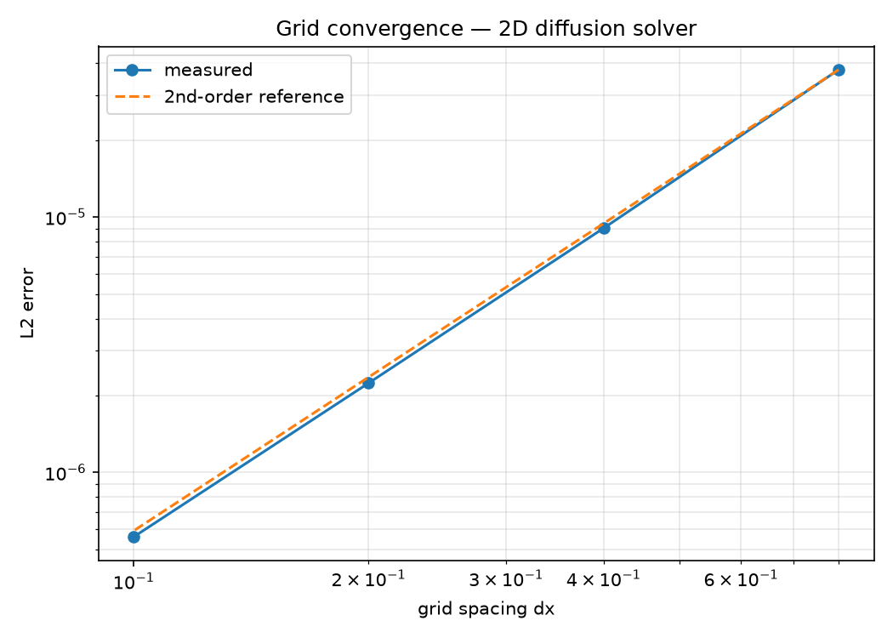

# GPU-Accelerated Diffusion Solver


A finite-difference solver for 2D diffusion-advection transport, implemented in
C++ and CUDA. Validated against analytical solutions and benchmarked against a
single-threaded CPU baseline.

Applied to concentration-gradient formation in microfluidic channels — the
physics behind my first-author research on a microfluidic drug-screening
platform.

## Validation

The solver is checked against the exact Gaussian solution for a point source
diffusing in an unbounded domain. Refining the grid reduces the L2 error at a
measured rate of **4.01× per halving of dx**, matching the second-order spatial
accuracy of the five-point central-difference stencil.



| Grid | dx | L2 error | ratio |
|------|-----|----------|-------|
| 51² | 0.80 | 3.78e-05 | — |
| 101² | 0.40 | 9.05e-06 | 4.17× |
| 201² | 0.20 | 2.24e-06 | 4.04× |
| 401² | 0.10 | 5.59e-07 | 4.01× |

Total mass is also conserved exactly under no-flux boundaries, verified as a
unit test.

## Performance

Same kernel, same results — the GPU output matches the CPU baseline
bit-for-bit at every grid size.


| Grid | CPU (ms) | GPU (ms) | Speedup |
|------|----------|----------|---------|
| 128² | 4.68 | 2.23 | 2.1× |
| 256² | 18.39 | 3.48 | 5.3× |
| 512² | 69.42 | 6.09 | 11.4× |
| 1024² | 288.00 | 18.69 | 15.4× |
| 2048² | 1268.61 | 97.91 | 13.0× |

*200 timesteps, double precision. NVIDIA GeForce RTX 4050 Laptop GPU,
CUDA 12.6, MSVC 19.41. CPU baseline is single-threaded.*

### Reading these numbers

**Speedup grows with problem size** because the GPU's fixed costs — memory
allocation, host-device transfer, kernel launch — are amortized over more
parallel work. At 128² the grid has only ~16k cells, too few to fill the
device.

**It peaks at 1024² and declines at 2048².** At that size each buffer is 32 MB
of doubles, so the working set exceeds cache and the kernel becomes bound by
memory bandwidth rather than compute. A five-point stencil performs few
arithmetic operations per byte loaded, so it is memory-bound by nature.

**Double precision is a significant handicap on this hardware.** Consumer
GeForce cards restrict FP64 throughput to a fraction of FP32. The 15× measured
here is on the restricted path; the same kernel in single precision would show
a substantially larger gap.

**GPU timings require a warmup.** CUDA context initialization cost over a
second on the first call — charged entirely to whichever measurement ran
first. The benchmark now discards a warmup run before timing.

## Building

Requires CMake 3.20+, a C++17 compiler, and optionally the CUDA Toolkit.
CUDA targets build only if a toolkit is found, so the CPU solver and its tests
build anywhere.

```bash
cmake -B build
cmake --build build --config Release
ctest --test-dir build -C Release --output-on-failure
```

On Windows, if CMake does not locate the toolkit automatically:

```bash
cmake -B build -T "cuda=C:/Program Files/NVIDIA GPU Computing Toolkit/CUDA/v12.6"
```

## Running

```bash
./build/diffusion 128 500     # simulate, write field.csv
./build/validate              # convergence study, write validation.csv
./build/benchmark             # CPU vs GPU timings, write benchmark.csv
```

Plots are generated from the CSVs:

```bash
python scripts/plot_validation.py
python scripts/plot_benchmark.py
```

## Design notes

**Row-major flat storage.** The grid is a single contiguous `std::vector`
rather than a vector of vectors — cache-friendly on CPU and required for a
single host-device transfer.

**Reflecting boundaries handled in-stencil.** An out-of-domain neighbour is
taken to equal the cell itself, contributing zero flux. An earlier version
copied edge values after the update, which broke mass conservation — caught by
the conservation test.

**Device-resident buffers.** Data is copied to the GPU once before the
timestep loop and back once after; the double-buffer swap exchanges pointers
on the device. Copying each step would make the GPU slower than the CPU.

## Status

- [x] CPU finite-difference diffusion solver
- [x] Analytical validation with measured convergence order
- [x] CUDA kernel, verified bit-identical to the CPU baseline
- [x] CPU vs GPU benchmark across grid sizes
- [ ] Advection term and microfluidic gradient-generator geometry
- [ ] Shared-memory tiling and roofline analysis
