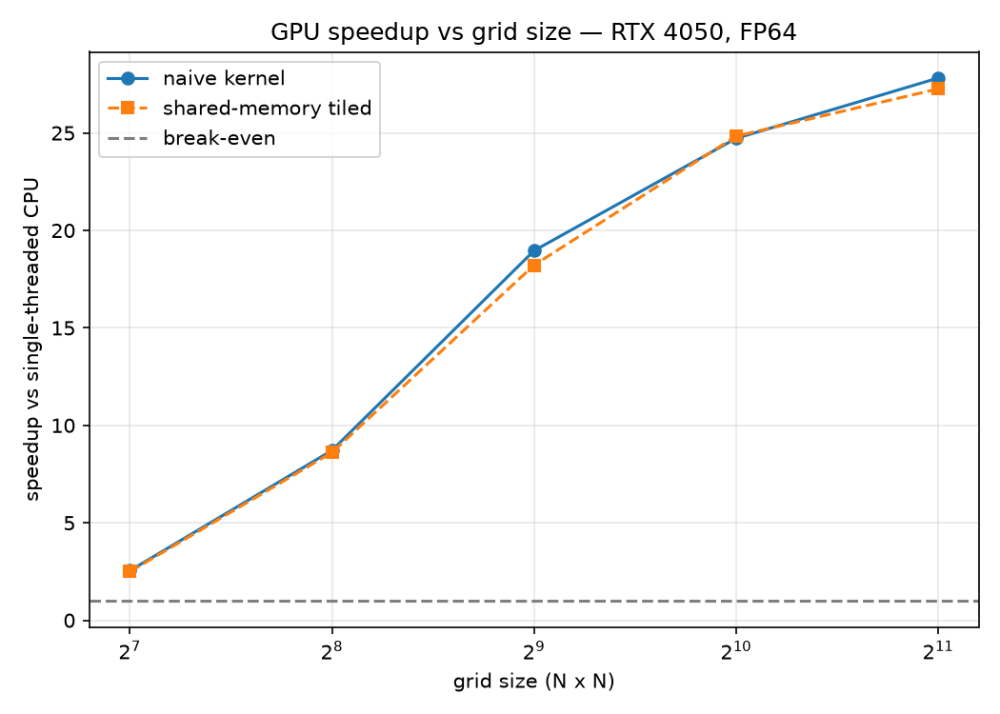
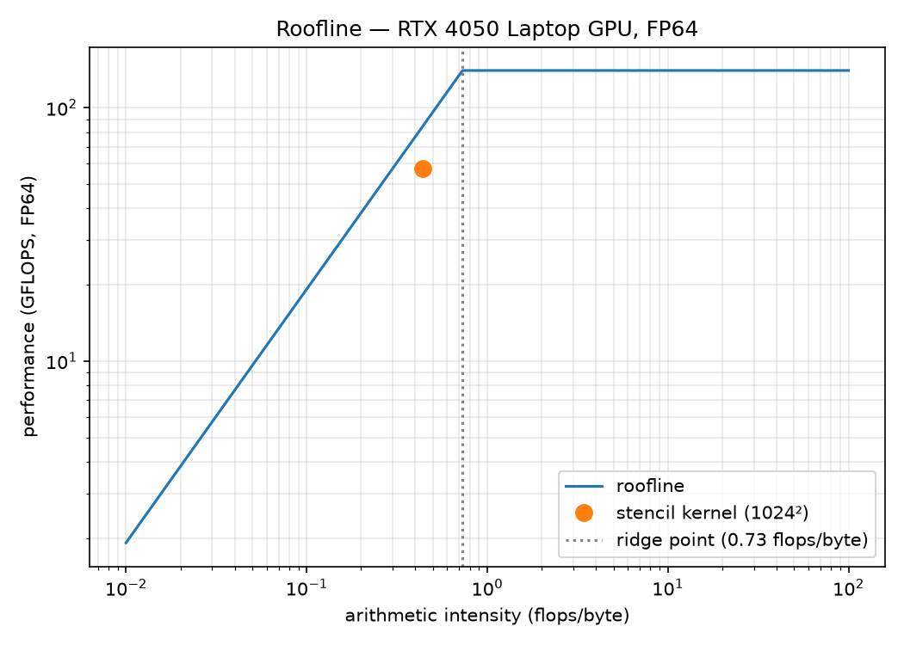
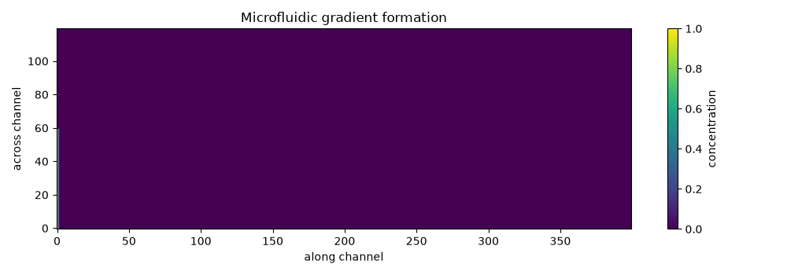
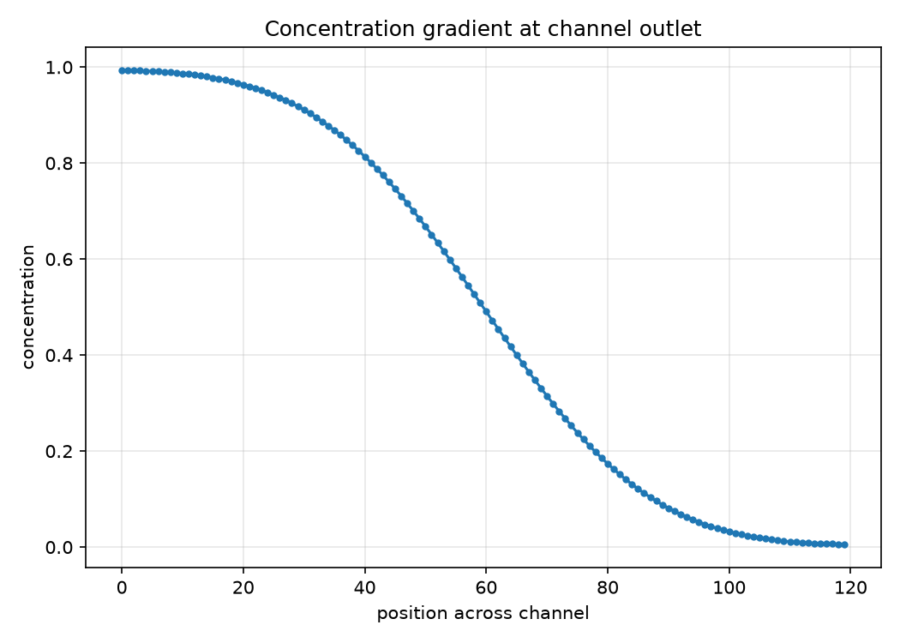

# GPU-Accelerated Diffusion Solver


A finite-difference solver for 2D diffusion-advection transport, implemented in
C++ and CUDA. Validated against analytical solutions and benchmarked against a
single-threaded CPU baseline.

Applied to concentration-gradient formation in microfluidic channels — the
physics behind my first-author research on a microfluidic drug-screening
platform.

## Validation

The solver is checked against the exact Gaussian solution for a point source
diffusing in an unbounded domain. Refining the grid reduces the L2 error at a
measured rate of **4.01× per halving of dx**, matching the second-order spatial
accuracy of the five-point central-difference stencil.


| Grid | dx | L2 error | ratio |
|------|-----|----------|-------|
| 51² | 0.80 | 3.78e-05 | — |
| 101² | 0.40 | 9.05e-06 | 4.17× |
| 201² | 0.20 | 2.24e-06 | 4.04× |
| 401² | 0.10 | 5.59e-07 | 4.01× |

Total mass is also conserved exactly under no-flux boundaries, verified as a
unit test.

## Performance

Both GPU kernels produce results identical to the CPU baseline to machine
precision.



| Grid | CPU (ms) | Naive GPU (ms) | Tiled GPU (ms) | Speedup | Tiled vs naive |
|------|----------|----------------|----------------|---------|----------------|
| 128² | 10.80 | 4.24 | 4.33 | 2.5× | 0.98× |
| 256² | 43.33 | 4.97 | 5.03 | 8.7× | 0.99× |
| 512² | 155.05 | 8.18 | 8.51 | 19.0× | 0.96× |
| 1024² | 631.20 | 25.53 | 25.41 | 24.7× | 1.00× |
| 2048² | 2901.19 | 104.30 | 106.43 | 27.8× | 0.98× |

*200 timesteps, double precision. NVIDIA GeForce RTX 4050 Laptop GPU,
CUDA 12.6, MSVC 19.41. CPU baseline is single-threaded.*

### Reading these numbers

**Speedup grows with problem size** because the GPU's fixed costs — memory
allocation, host-device transfer, kernel launch — are amortized over more
parallel work. At 128² the grid has only ~16k cells, too few to fill the
device.

**Double precision is a significant handicap on this hardware.** Consumer
GeForce cards restrict FP64 throughput to 1/64 of FP32. The ~28× measured here
is on the restricted path; the same kernel in single precision would run
substantially faster.

**GPU timings require a warmup.** CUDA context initialisation cost over a
second on the first call — charged entirely to whichever measurement ran first.
The benchmark discards a warmup run before timing.

**CPU timings vary between runs** on a laptop under thermal and background
load; the figures above are from a single run and shifted by up to 2× across
sessions.

### Shared-memory tiling did not help — and the roofline explains why

The naive kernel reads each cell's four neighbours from global memory, so a
value can be fetched up to five times. The textbook optimisation is to stage a
tile of the grid in shared memory with a one-cell halo, synchronise, then
compute entirely on-chip. I implemented that kernel and it produced identical
results — but no speedup, and marginally slower at most sizes.

The roofline model explains the outcome.



The stencil performs about 7 floating-point operations per cell while moving at
minimum 16 bytes (one read, one write), giving an arithmetic intensity of
**0.44 flops/byte**. The ridge point for this card — FP64 peak divided by
memory bandwidth — is **140 GFLOPS / 192 GB/s ≈ 0.73 flops/byte**. Since 0.44
sits below the ridge, the kernel is memory-bound by construction: no amount of
compute optimisation can help.

At that arithmetic intensity, the bandwidth ceiling is 0.44 × 192 GB/s ≈
**84 GFLOPS**. The measured throughput at 1024² is
7 × 1024² × 200 / 25.5 ms ≈ **57.5 GFLOPS**, or about **68% of the ceiling**.

So the kernel was already close to the hardware limit, and the remaining gap
was not redundant global reads — Ada's L2 cache was already servicing most of
the neighbour reuse, since a stencil's access pattern is highly local. Shared
memory re-implemented in software, with an added `__syncthreads()` barrier and
divergent halo-loading branches, a reuse the cache provided for free.

Getting further would require changing the algorithm rather than the memory
access pattern — temporal blocking to do several timesteps per load, or single
precision, which on consumer GeForce hardware runs 64× faster than FP64 and
would move the arithmetic intensity and the ceiling together.


## Microfluidic gradient generation

Two co-flowing streams - one at unit concentration, one at zero - enter a 400x120 channel and mix by diffusion as advection carries them downstream. This is the mechanism behind microfluidic gradient generators, including the device in my first-author publication. 



The outlet concentration profile is a smooth sigmoid, approximately linear
across the central half of the channel:



The advection term uses upwind differencing rather than a centred stencil,
which is unstable for hyperbolic terms. Upwind is first-order accurate, so the
combined scheme is second-order in the diffusive term and first-order in the
advective one. The timestep must satisfy both the diffusive stability limit and
the CFL condition; `max_stable_dt_advective` returns the tighter of the two.


## Building

Requires CMake 3.20+, a C++17 compiler, and optionally the CUDA Toolkit.
CUDA targets build only if a toolkit is found, so the CPU solver and its tests
build anywhere.

```bash
cmake -B build
cmake --build build --config Release
ctest --test-dir build -C Release --output-on-failure
```

On Windows, if CMake does not locate the toolkit automatically:

```bash
cmake -B build -T "cuda=C:/Program Files/NVIDIA GPU Computing Toolkit/CUDA/v12.6"
```

## Running

```bash
./build/diffusion 128 500     # simulate, write field.csv
./build/validate              # convergence study, write validation.csv
./build/benchmark             # CPU vs GPU timings, write benchmark.csv
./build/gradient              # gradient simulation, write frames/
```

Plots are generated from the CSVs:

```bash
python scripts/plot_validation.py
python scripts/plot_benchmark.py
python scripts/plot_roofline.py
```

## Design notes

**Row-major flat storage.** The grid is a single contiguous `std::vector`
rather than a vector of vectors — cache-friendly on CPU and required for a
single host-device transfer.

**Reflecting boundaries handled in-stencil.** An out-of-domain neighbour is
taken to equal the cell itself, contributing zero flux. An earlier version
copied edge values after the update, which broke mass conservation — caught by
the conservation test.

**Device-resident buffers.** Data is copied to the GPU once before the
timestep loop and back once after; the double-buffer swap exchanges pointers
on the device. Copying each step would make the GPU slower than the CPU.

**Boundary conditions re-imposed per step.** The inlet is held fixed by a callback applied after each timestep, so the two streams keep feeding rather than washing downstream.

## Status

- [x] CPU finite-difference diffusion solver
- [x] Analytical validation with measured convergence order
- [x] CUDA kernel, verified against the CPU baseline
- [x] CPU vs GPU benchmark across grid sizes
- [x] Advection with upwind differencing
- [x] Microfluidic gradient-generator simulation
- [x] Shared-memory tiling and roofline analysis
- [ ] Branching "Christmas tree" channel geometry
